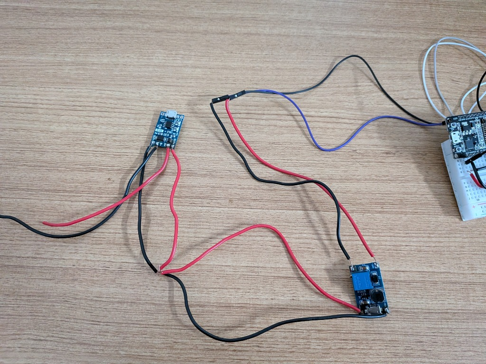
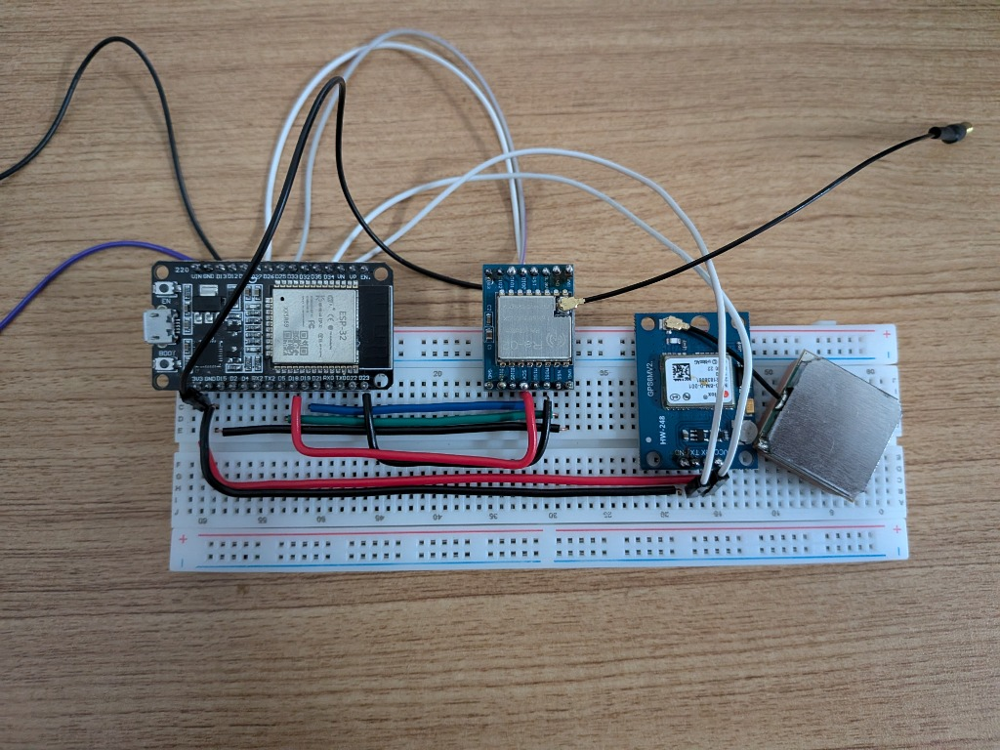
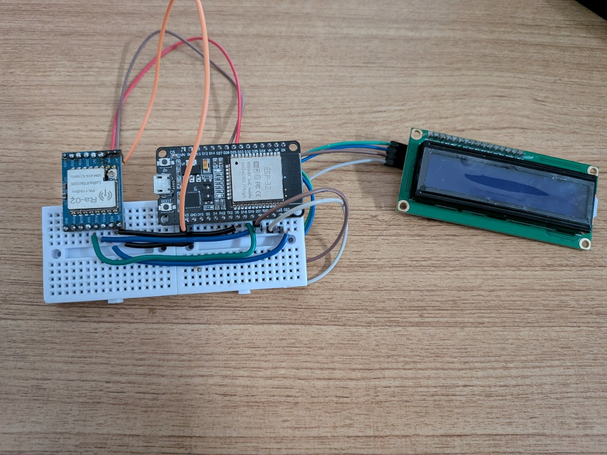

# 🛠️ Project Verona — Deployment & Hardware Assembly Guide

This guide walks you through safely assembling, calibrating, wiring, and flashing the **Romeo (Transmitter)** and **Juliet (Receiver)** nodes.

---

## ⚠️ Critical Safety & Pre-Assembly Rules

> [!CAUTION]
> **1. NEVER power up an SX1278 (Ra-02) LoRa module without its 433 MHz antenna connected.**
> Operating the RF transmitter without an antenna reflects power back into the power amplifier (high VSWR), which can permanently destroy the LoRa module within seconds.
>
> **2. Calibrate the MT3608 Boost Converter BEFORE connecting it to the ESP32.**
> MT3608 modules straight from the factory are often adjusted to output 12V–28V. Connecting an uncalibrated boost converter will permanently destroy the ESP32!
>
> **3. Turn OFF Switch SW1 while charging the battery via USB-C (TP4056).**
> The TP4056 module does not support power-path management. If the ESP32 draws current while charging, the TP4056 cannot detect the termination current threshold ($C/10$), which can lead to overcharging and battery degradation.

---

## 🧰 Tools & Equipment Required

* Digital Multimeter (for voltage measurement)
* Small flathead precision screwdriver (for MT3608 trimpot RV1 adjustment and LCD contrast trimpot)
* Breadboards (1 full-size for Romeo, 1 half-size for Juliet) or perfboards
* Male-to-Male jumper wires
* Soldering iron & solder (if header pins are not pre-soldered)
* 2x Micro-USB or USB-C data cables (for PC serial monitoring & flashing)

---

## 🔋 Step 1: Power Supply Calibration (Romeo Node)

```
[3.7V Li-ion Cell] ──> [TP4056 B+/B-] ──(OUT+/OUT-)──> [SW1 Switch] ──> [MT3608 IN+/IN-]
```

<p align="center">
  
  <br>
  <em>Figure: Physical power supply setup showing TP4056 (top-left) connected to MT3608 boost converter (bottom-right)</em>
</p>

1. Solder or connect your **3.7V 18650 / Li-Po cell** to the `B+` and `B-` terminals of the **TP4056** charger module.
2. Connect `TP4056 OUT+` to one terminal of **SW1 (SPST Switch)**.
3. Connect the other terminal of **SW1** to `MT3608 IN+`.
4. Connect `TP4056 OUT-` directly to `MT3608 IN-` and to your breadboard ground rail.
5. **DO NOT connect the ESP32 VIN pin yet.**
6. Close switch **SW1** (turn ON).
7. Set your digital multimeter to DC Volts and probe `MT3608 OUT+` and `MT3608 OUT-`.
8. Using a small screwdriver, rotate trimpot **RV1** counter-clockwise (typically 10–20 turns) until the multimeter reads exactly **5.00 V** (±0.05 V).
9. Open switch **SW1** (turn OFF). It is now safe to wire `OUT+` to the ESP32 `VIN` pin.

---

## ⚡ Step 2: Wiring & Assembly

### Node A: Romeo (Transmitter)

Refer to schematic: `docs/Romeo_Circuit_Diagram.svg` and hardware photo below:

<p align="center">
  
  <br>
  <em>Figure: Top-down wiring reference of the Romeo node on the breadboard</em>
</p>

| Source Component & Pin | Target Component & Pin | Function / Wire Net |
| :--- | :--- | :--- |
| **MT3608 OUT+** | **ESP32 VIN** | 5V Main Power Input |
| **MT3608 OUT-** | **ESP32 GND** (Header 1) | Common System Ground |
| **ESP32 3V3** | **Breadboard +3.3V Rail** | Regulated 3.3V Logic Bus |
| **ESP32 GND** | **Breadboard GND Rail** | System Ground Bus |
| **Ra-02 3.3V** | **Breadboard +3.3V Rail** | RF Radio Power (3.3V ONLY!) |
| **Ra-02 GND** | **Breadboard GND Rail** | RF Radio Ground |
| **Ra-02 NSS** | **ESP32 D5** (GPIO 5) | SPI Chip Select |
| **Ra-02 RST** | **ESP32 D14** (GPIO 14) | Hardware Reset |
| **Ra-02 DIO0** | **ESP32 D26** (GPIO 26) | Packet Interrupt |
| **Ra-02 SCK** | **ESP32 D18** (GPIO 18) | SPI Clock |
| **Ra-02 MISO** | **ESP32 D19** (GPIO 19) | SPI Master In Slave Out |
| **Ra-02 MOSI** | **ESP32 D23** (GPIO 23) | SPI Master Out Slave In |
| **GY-GPS6MV2 VCC** | **Breadboard +3.3V Rail** | GPS Logic & Power |
| **GY-GPS6MV2 GND** | **Breadboard GND Rail** | GPS Ground |
| **GY-GPS6MV2 TX** | **ESP32 D32** (GPIO 32) | HardwareSerial UART RX |
| **GY-GPS6MV2 RX** | **ESP32 D33** (GPIO 33) | HardwareSerial UART TX |
| **Electrolytic Cap C1**| Across +3.3V and GND rails | 100 µF (observing polarity) for RF decoupling |

---

### Node B: Juliet (Receiver & Base Station)

Refer to schematic: `docs/Juliet_Circuit_Diagram.svg` and hardware photo below:

<p align="center">
  
  <br>
  <em>Figure: Top-down wiring reference of the Juliet receiver and 16x2 I2C LCD on the breadboard</em>
</p>

| Source Component & Pin | Target Component & Pin | Function / Wire Net |
| :--- | :--- | :--- |
| **USB Cable** | **ESP32 USB Socket** | 5V USB Bus & Serial Telemetry |
| **ESP32 VIN** | **LCD 16x2 VCC** | 5V Display Power |
| **ESP32 GND** | **LCD 16x2 GND** | Display Ground |
| **ESP32 D21** (GPIO 21) | **LCD 16x2 SDA** | I2C Serial Data |
| **ESP32 D22** (GPIO 22) | **LCD 16x2 SCL** | I2C Serial Clock |
| **ESP32 3V3** | **Ra-02 3.3V** | LoRa Radio Power (3.3V ONLY!) |
| **ESP32 GND** | **Ra-02 GND** | LoRa Radio Ground |
| **Ra-02 NSS** | **ESP32 D5** (GPIO 5) | SPI Chip Select |
| **Ra-02 RST** | **ESP32 D14** (GPIO 14) | Hardware Reset |
| **Ra-02 DIO0** | **ESP32 D26** (GPIO 26) | Packet Interrupt |
| **Ra-02 SCK** | **ESP32 D18** (GPIO 18) | SPI Clock |
| **Ra-02 MISO** | **ESP32 D19** (GPIO 19) | SPI Master In Slave Out |
| **Ra-02 MOSI** | **ESP32 D23** (GPIO 23) | SPI Master Out Slave In |
| **Electrolytic Cap C1**| Across +3.3V and GND rails | 100 µF decoupling buffer |

---

## 💻 Step 3: Firmware Flashing

### Option A: Using PlatformIO (Recommended)

1. Open the repository root in VS Code with PlatformIO extension installed.
2. Connect the **Romeo** node via USB.
3. Build and flash the Romeo firmware:
   ```bash
   pio run -e romeo --target upload
   ```
4. Disconnect Romeo, connect the **Juliet** node via USB.
5. Build and flash the Juliet firmware:
   ```bash
   pio run -e juliet --target upload
   ```

### Option B: Using Arduino IDE

1. Install Arduino IDE (v2.x recommended).
2. Install **ESP32 board package** via Boards Manager:
   `https://raw.githubusercontent.com/espressif/arduino-esp32/gh-pages/package_esp32_index.json`
3. Install required libraries via Library Manager:
   * **LoRa** by *Sandeep Mistry* (v0.8.0)
   * **TinyGPSPlus** by *Mikal Hart* (v1.0.3)
   * **LiquidCrystal_I2C** by *Frank de Brabander* (v1.1.2)
4. Flash Romeo:
   * Open `firmware/Romeo/Romeo.ino`
   * Select Board: `DOIT ESP32 DEVKIT V1` (or your ESP32 model)
   * Click **Upload**
5. Flash Juliet:
   * Open `firmware/Juliet/Juliet.ino`
   * Select Board & Port
   * Click **Upload**

---

## 🔍 Step 4: Verification & Bench Testing

1. **Juliet First Boot:**
   * Power Juliet via USB and open Serial Monitor at `9600 baud` (or `115200` for PlatformIO).
   * Verify the LCD backlight illuminates and shows:
     ```
     Project Verona
     Waiting LoRa...
     ```
   * *If LCD is blank or shows white boxes:* Gently turn the blue trimpot on the back of the I2C backpack until text appears. If still blank, verify the I2C address (set to `0x26` in code as confirmed by scanner; standard modules may use `0x27` or `0x3F`).

2. **Romeo First Boot:**
   * Attach the 433 MHz antenna and ceramic GPS antenna.
   * Place Romeo near an open window or outdoors for first GPS satellite lock (30–60 seconds).
   * Verify Romeo serial output:
     ```
     Romeo: Initializing LoRa... OK
     GPS Fix acquired! Lat: 12.971600, Lon: 77.594600
     Sending PING... Waiting ACK...
     ```

3. **Ping-Pong Loop:**
   * Juliet receives packet, computes RSSI/SNR, updates the LCD:
     ```
     Lat: 12.971600
     Lon: 77.594600
     ```
   * Juliet transmits `ACK` packet. Romeo receives `ACK` and confirms two-way link closure.

---

## ❓ Troubleshooting

| Issue | Probable Cause | Remedy |
| :--- | :--- | :--- |
| **"Starting LoRa failed!" on boot** | Loose wiring on SPI lines (D5, D18, D19, D23, D14, D26) | Double check jumper wires. Ensure Ra-02 is connected to 3.3V, NOT 5V. |
| **LCD displays black/white blocks** | Contrast potentiometer out of calibration | Rotate the blue trimmer screw on the LCD back until characters become clear. |
| **LCD I2C bus not detected** | Incorrect I2C address | Run an I2C scanner sketch. Confirmed address for this build is `0x26`; other PCF8574 backpacks use `0x27` or `0x3F`. |
| **GPS shows "Waiting for fix..." indefinitely** | Indoors with no line-of-sight to satellites | Move the GPS patch antenna outdoors under clear sky. Ensure patch antenna is facing UP. |
| **Romeo brownouts/resets during transmission** | Voltage dip when LoRa transmits at +17 dBm | Add the 100 µF electrolytic capacitor across 3.3V and GND rails near the Ra-02. |
