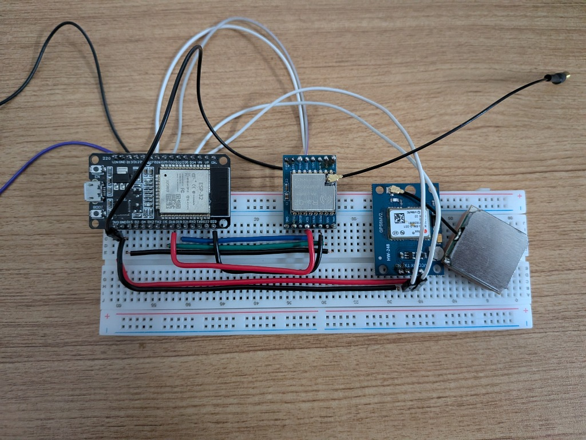
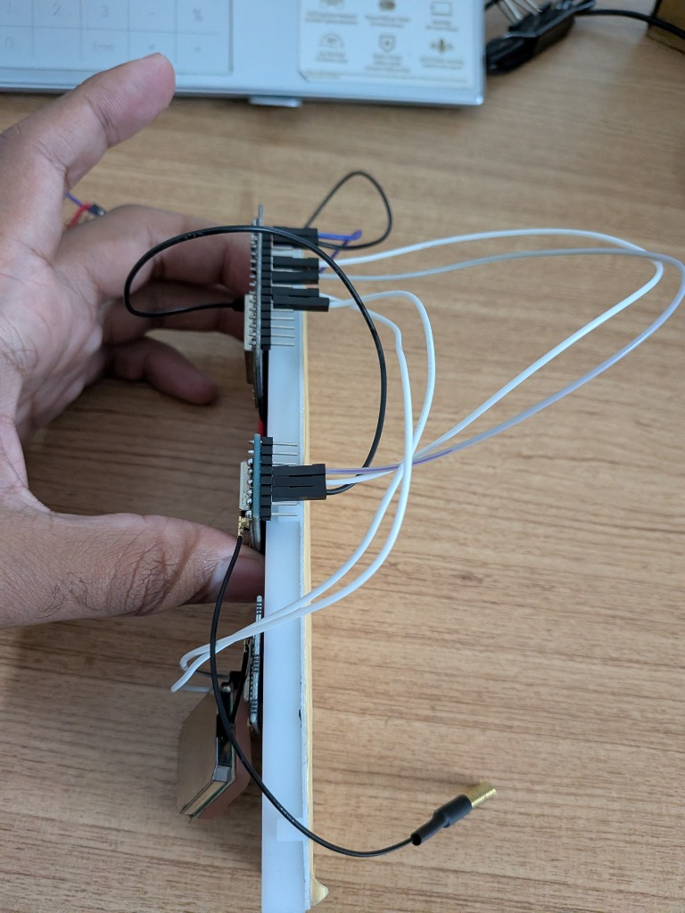
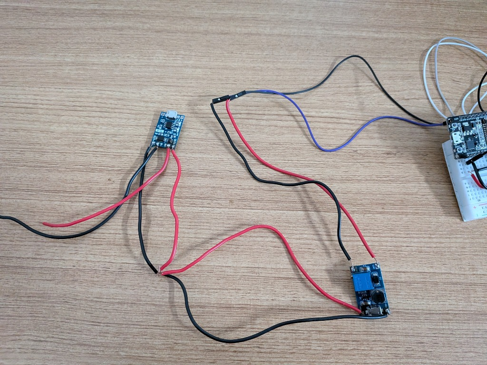
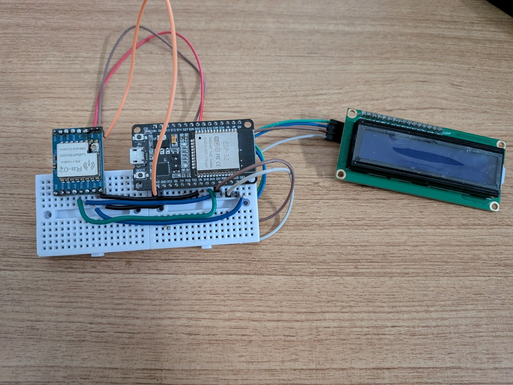
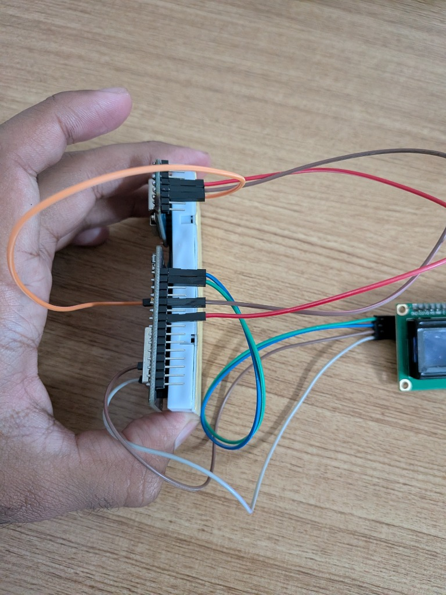

<div align="center">

# 📡 Project Verona
### Long-Range Off-Grid GPS Telemetry & Base Station System

[](https://www.espressif.com/)
[](https://www.semtech.com/products/wireless-rf/lora-connect/sx1278)
[](https://www.u-blox.com/)
[](https://platformio.org/)
[](https://www.arduino.cc/)
[](LICENSE)

<p align="center">
  <b>A reliable, off-grid telemetry link named after Shakespeare's star-crossed lovers.</b><br>
  <b>Romeo</b> (remote transmitter) traverses the field broadcasting its exact GPS coordinates,<br>
  while <b>Juliet</b> (base station receiver) listens, acknowledges, and renders real-time telemetry on an LCD.
</p>

[Quickstart](#-quickstart--flashing-guide) • [Hardware Showcase](#-hardware-showcase--circuit-schematics) • [Romeo Troubleshooting](TROUBLESHOOTING_ROMEO.md) • [Juliet Troubleshooting](TROUBLESHOOTING_JULIET.md) • [Deployment Guide](DEPLOYMENT_GUIDE.md) • [Limitations](LIMITATIONS.md)

---

</div>

## 📑 Table of Contents
- [📖 Overview & Operational Narrative](#-overview--operational-narrative)
- [🎯 Problem Statement](#-problem-statement)
- [💡 Proposed Solution](#-proposed-solution)
- [📸 Hardware Showcase & Circuit Schematics](#-hardware-showcase--circuit-schematics)
- [🛠️ Hardware Stack & Bill of Materials](#️-hardware-stack--bill-of-materials)
- [⚡ Pin Mapping & Wiring Reference](#-pin-mapping--wiring-reference)
- [📡 Radio Protocol & Packet Specification](#-radio-protocol--packet-specification)
- [🚀 Quickstart & Flashing Guide](#-quickstart--flashing-guide)
- [🔍 Hardware Troubleshooting Guides](#-hardware-troubleshooting-guides)
- [📂 Project Structure](#-project-structure)
- [⚖️ Engineering Scope & Limitations](#️-engineering-scope--limitations)
- [🔮 Future Scope & Roadmap](#-future-scope--roadmap)
- [📄 License & Authors](#-license--authors)

---

## 📖 Overview & Operational Narrative

Modern search-and-rescue, wilderness trekking, drone recovery, and agricultural tracking operations frequently take place in radio-denied, remote environments where cellular networks (4G/5G) and Wi-Fi are non-existent.

**Project Verona** solves this problem by pairing low-power sub-GHz **SX1278 LoRa (433 MHz)** radio transceivers with high-performance **ESP32 dual-core microcontrollers**:
* **Romeo (Remote Mobile Tracker):** Operates untethered on a single-cell Li-ion battery (3.7V boosted to 5.0V via MT3608). It ingests real-time NMEA sentences from a u-blox GPS module over hardware UART. Once a verified satellite lock is achieved, Romeo encapsulates its latitude and longitude into an RF packet and broadcasts across the ISM band: *"Wherefore art thou?"*
* **Juliet (Fixed Base Station):** Powered continuously via USB. Juliet monitors the 433 MHz channel. Upon capturing Romeo's packet, Juliet verifies packet integrity, extracts geographic coordinates, computes the signal RSSI / SNR, renders the live position to an HD44780 16x2 I2C LCD display, outputs telemetry to the host workstation over serial, and instantly returns an `ACK` packet: *"Here I am."*

---

## 🎯 Problem Statement

In wilderness exploration, disaster relief, drone telemetry, and remote search-and-rescue operations, cellular networks (4G/5G) and public Wi-Fi infrastructure are frequently unavailable. Commercial satellite-based emergency beacons (such as Garmin inReach or Iridium SPOT) offer coverage but impose expensive recurring monthly subscriptions, proprietary closed ecosystems, and heavy power drains that limit scalability for small teams, hobbyists, and grassroots first responders.

Furthermore, off-the-shelf consumer GPS trackers lack local field diagnostic visibility and point-to-point independence. Without an external cloud server or internet gateway, field personnel cannot directly view or verify remote coordinates in real time, while power-hungry radios quickly deplete portable battery packs, leaving rescue teams blind when reliable, off-grid location tracking is most critical.

---

## 💡 Proposed Solution

Project Verona delivers a decentralized, license-free, long-range telemetry system by pairing dual-core ESP32 microcontrollers with Semtech SX1278 LoRa transceivers operating in the 433 MHz ISM band. The mobile transmitter node (**Romeo**) harvests high-accuracy geospatial coordinates from a u-blox NEO-6M GPS module, packages the telemetry into compact ASCII frames, and broadcasts them across multi-kilometer distances on a single 3.7V Li-ion battery boosted to 5.0V.

At the base camp, the receiving node (**Juliet**) continuously listens for incoming transmissions, computes signal health metrics (RSSI and SNR), and instantly renders live latitude, longitude, and link quality on an onboard HD44780 16x2 I2C LCD without requiring an external computer or network. Juliet immediately echoes an acknowledgment (ACK) frame back to Romeo, verifying bidirectional link integrity and establishing a robust, zero-cost, off-grid telemetry pipeline.

```
┌─────────────────────────────────────────────────────────────────────────────┐
│                             PROJECT VERONA TOPOLOGY                         │
└─────────────────────────────────────────────────────────────────────────────┘

  ROMEO (Field Mobile Node)                              JULIET (Base Station)
  ┌───────────────────────┐                              ┌───────────────────┐
  │ 3.7V Li-ion + TP4056  │                              │ USB 5V Main Power │
  │    + MT3608 (5.0V)    │                              └─────────┬─────────┘
  └───────────┬───────────┘                                        │
              ▼                                                    ▼
  ┌───────────────────────┐                              ┌───────────────────┐
  │     ESP32 Node U1     │                              │   ESP32 Node U1   │
  │   (Classic DevKit)    │                              │ (Classic DevKit)  │
  └───┬───────────────┬───┘                              └───┬───────────┬───┘
      │ UART          │ SPI                                  │ SPI       │ I2C
      ▼ (D32/D33)     ▼ (D5/14/26/18/19/23)                  ▼           ▼ (D21/D22)
  ┌───────────┐   ┌───────────┐                      ┌───────────┐   ┌───────────┐
  │ u-blox    │   │  Ra-02    │                      │  Ra-02    │   │ 16x2 LCD  │
  │ NEO-6M GPS│   │  SX1278   │                      │  SX1278   │   │ (PCF8574) │
  └─────┬─────┘   └─────┬─────┘                      └─────┬─────┘   └───────────┘
        │               │                                  │
    [Patch Ant]    [433MHz Ant]                       [433MHz Ant]
                        │                                  │
                        └─── ))) 433 MHz LoRa RF ((( ──────┘
                                  PING,lat,lon ──>
                                  <── ACK
```

---

## 📸 Hardware Showcase & Circuit Schematics

### 1. Romeo (Field Transmitter Node)
The mobile field tracker captures satellite fixes via GPS, formats telemetry packets, and broadcasts them over the 433 MHz LoRa channel.

#### 📷 Real Hardware Prototype
<p align="center">
  
  <br>
  <em>Figure 1: Romeo Field Node Assembly — ESP32 (left), Ra-02 433 MHz LoRa transceiver (center), and u-blox NEO-6M GPS with ceramic patch antenna (right).</em>
</p>

<p align="center">
  
  <br>
  <em>Figure 2: Breadboard side profile showcasing clean pin header seating, RF u.FL coaxial pigtail, and point-to-point interconnects.</em>
</p>

<p align="center">
  
  <br>
  <em>Figure 3: Power supply assembly — TP4056 Li-ion charger with battery protection (top-left) feeding the MT3608 DC-DC step-up boost converter (bottom-right) calibrated to 5.00 V.</em>
</p>

#### 📐 Circuit Schematic (Rev 1.1)
The full vector circuit schematic is located in the repository at:
* 📁 **[`docs/Romeo_Circuit_Diagram.svg`](docs/Romeo_Circuit_Diagram.svg)**

*(For full wiring netlists, pin mappings, and electrical analysis, see [`docs/Circuit_Documentation.md`](docs/Circuit_Documentation.md))*

---

### 2. Juliet (Base Station & Receiver Node)
The USB-powered base station listens for incoming LoRa broadcasts, validates CRC/format, calculates RSSI/SNR metrics, updates the 16x2 I2C LCD, and transmits an immediate ACK packet.

#### 📷 Real Hardware Prototype
<p align="center">
  
  <br>
  <em>Figure 4: Juliet Base Station Assembly — Ra-02 433 MHz LoRa transceiver (left), ESP32 Dev Module (center), and HD44780 16x2 LCD with PCF8574 I2C backpack (right).</em>
</p>

<p align="center">
  
  <br>
  <em>Figure 5: Side profile of Juliet node illustrating I2C display cable harness (SDA: D21, SCL: D22, VCC: VIN, GND: GND) and Ra-02 SPI bus.</em>
</p>

#### 📐 Circuit Schematic (Rev 1.1)
The full vector circuit schematic is located in the repository at:
* 📁 **[`docs/Juliet_Circuit_Diagram.svg`](docs/Juliet_Circuit_Diagram.svg)**

*(For full wiring netlists, pin mappings, and electrical analysis, see [`docs/Circuit_Documentation.md`](docs/Circuit_Documentation.md))*

---

## 🛠️ Hardware Stack & Bill of Materials

### Romeo (Transmitter Node)

| Ref Des | Component | Specification / Value | Function |
| :--- | :--- | :--- | :--- |
| **U1** | ESP32 Dev Module | Dual Core Xtensa 240MHz, 30/38-pin | Central processing & telemetry controller |
| **U2** | Ai-Thinker Ra-02 | Semtech SX1278, 433 MHz, SPI | Long-range RF transceiver |
| **U3** | GY-GPS6MV2 | u-blox NEO-6M / NEO-7M GPS | Position sensor (NMEA 9600 baud) |
| **BT1**| Li-ion Battery | 3.7 V, 1000 mAh+ (18650 or LiPo) | Portable DC power source |
| **U4** | TP4056 Board | Type-C USB with battery protection | Constant-current / constant-voltage charging |
| **SW1**| SPST Switch | Slide or toggle rated 1A+ | System power toggle (OFF during charging) |
| **U5** | MT3608 Module | DC-DC Step-Up (boost to 5.00 V) | Voltage booster to ESP32 VIN |
| **C1** | Electrolytic Cap | 100 µF, 10V+ | Decoupling buffer across Ra-02 3V3/GND |
| **J1** | u.FL Antenna Cable | IPEX (u.FL) RF pigtail with integrated element | Primary 433 MHz RF antenna (attached by default) |
| **ANT1**| Rubber-Duck Antenna | 433 MHz SMA whip antenna (50 Ω) | **Optional**: External high-gain antenna for extended range |
| **ANT2**| Ceramic Antenna | Patch antenna with u.FL cable | GPS satellite reception antenna |

> [!NOTE]
> **Antenna Note:** The u.FL (IPEX) cable snapped onto the Ra-02 is already equipped with an integrated monopole antenna element by default, which provides solid RF transmission and reception out of the box. An external SMA rubber-duck whip antenna (`ANT1`) is **optional** and only recommended if extreme long-range field testing is desired.

### Juliet (Receiver / Base Station)

| Ref Des | Component | Specification / Value | Function |
| :--- | :--- | :--- | :--- |
| **U1** | ESP32 Dev Module | Dual Core Xtensa 240MHz, 30/38-pin | Base station controller |
| **U2** | Ai-Thinker Ra-02 | Semtech SX1278, 433 MHz, SPI | Long-range RF transceiver |
| **U3** | 16x2 LCD Display | HD44780 + PCF8574 I2C backpack (5V) | On-station coordinates display |
| **C1** | Electrolytic Cap | 100 µF, 10V+ | Decoupling buffer across Ra-02 3V3/GND |
| **J1** | u.FL Antenna Cable | IPEX (u.FL) RF pigtail with integrated element | Primary 433 MHz RF antenna (attached by default) |
| **ANT1**| Rubber-Duck Antenna | 433 MHz SMA whip antenna (50 Ω) | **Optional**: External high-gain antenna for base station |
| **J3** | USB Cable | Micro-USB or USB-C data cable | 5V PC power & serial telemetry link |

---

## ⚡ Pin Mapping & Wiring Reference

### Master GPIO Allocation (ESP32 Dev Module)

| Subsystem | Signal Name | DevKit Silkscreen | ESP32 GPIO | Connected Module Pin | Logic Level |
| :--- | :--- | :--- | :--- | :--- | :--- |
| **LoRa (SPI)** | `LORA_NSS` | **D5** | GPIO 5 | Ra-02 `NSS` | 3.3 V |
| **LoRa (SPI)** | `LORA_RST` | **D14** | GPIO 14 | Ra-02 `RST` | 3.3 V |
| **LoRa (SPI)** | `LORA_DIO0`| **D26** | GPIO 26 | Ra-02 `DIO0` (Rx/Tx Done) | 3.3 V |
| **LoRa (SPI)** | `LORA_SCK` | **D18** | GPIO 18 | Ra-02 `SCK` | 3.3 V |
| **LoRa (SPI)** | `LORA_MISO`| **D19** | GPIO 19 | Ra-02 `MISO` | 3.3 V |
| **LoRa (SPI)** | `LORA_MOSI`| **D23** | GPIO 23 | Ra-02 `MOSI` | 3.3 V |
| **GPS (UART2)**| `GPS_TX_PIN`| **D32** | GPIO 32 | GPS Module `TX` | 3.3 V |
| **GPS (UART2)**| `GPS_RX_PIN`| **D33** | GPIO 33 | GPS Module `RX` | 3.3 V |
| **LCD (I2C)**  | `I2C_SDA`   | **D21** | GPIO 21 | LCD Backpack `SDA` | 5.0 V / 3.3 V |
| **LCD (I2C)**  | `I2C_SCL`   | **D22** | GPIO 22 | LCD Backpack `SCL` | 5.0 V / 3.3 V |

> [!IMPORTANT]
> **1. D32 / D33 UART Crossover:** Pins `D32` and `D33` are ordinary GPIOs mapped to `HardwareSerial(2)` in software. They leave hardware `RX2/TX2` (GPIO 16/17) unencumbered, preventing memory bus crashes on ESP32-WROVER boards with PSRAM. Note the crossover: **GPS TX connects to ESP32 D32**, and **GPS RX connects to ESP32 D33**.
>
> **2. 3.3V Ra-02 Voltage Warning:** NEVER connect the Ra-02 module to 5V. It must always be powered from the regulated 3.3V rail.

---

## 📡 Radio Protocol & Packet Specification

### Transaction Flow
The communication link operates on a half-duplex, stop-and-wait ARQ (Automatic Repeat reQuest) sequence:

```
  ROMEO (Transmitter)                                      JULIET (Receiver)
         │                                                         │
         │─── [PING,lat,lon] (433 MHz LoRa) ──────────────────────>│
         │    e.g. "PING,12.971600,77.594600"                      │ [Decode lat/lon]
         │                                                         │ [Update 16x2 LCD]
         │                                                         │ [Compute RSSI/SNR]
         │<── [ACK] ───────────────────────────────────────────────│
         │    "ACK"                                                │
         │ [Link verified, wait 3s]                                │
```

### Packet Definitions

| Packet ID | Direction | Format (ASCII) | Example | Description |
| :--- | :--- | :--- | :--- | :--- |
| **PING** | Romeo → Juliet | `PING,<lat>,<lon>` | `PING,12.971600,77.594600` | Carries 6-decimal floating-point latitude and longitude. Only broadcast when GPS fix age < 5000 ms. |
| **ACK**  | Juliet → Romeo | `ACK` | `ACK` | Acknowledgment packet sent immediately upon valid receipt of PING. |

### RF Modulation Parameters
* **Carrier Frequency:** 433.00 MHz
* **Bandwidth (BW):** 125 kHz
* **Spreading Factor (SF):** 7 (default)
* **Coding Rate (CR):** 4/5
* **Preamble Length:** 8 symbols
* **Sync Word:** `0xF3` (SX127X private network)

---

## 🚀 Quickstart & Flashing Guide

Complete step-by-step hardware assembly, MT3608 trimmer calibration, and flashing instructions are detailed in [**DEPLOYMENT_GUIDE.md**](DEPLOYMENT_GUIDE.md):

* [**PlatformIO (Recommended)**](DEPLOYMENT_GUIDE.md#-option-a-platformio-deployment-recommended): Build and flash firmware directly from the project root:
  * **Romeo (Transmitter):** `pio run -e romeo -t upload` (Monitor: `pio device monitor -b 9600`)
  * **Juliet (Receiver):** `pio run -e juliet -t upload` (Monitor: `pio device monitor -b 9600`)
  * **I2C Diagnostic Scanner:** `pio run -e i2c_scan -t upload`
* [**Arduino IDE**](DEPLOYMENT_GUIDE.md#-option-b-arduino-ide-deployment): Install `LoRa`, `TinyGPSPlus`, and `LiquidCrystal_I2C` libraries; flash `firmware/Romeo/Romeo.ino` and `firmware/Juliet/Juliet.ino` using board target `DOIT ESP32 DEVKIT V1` (9600 baud).

---

## 🔍 Hardware Troubleshooting Guides

Dedicated, field-tested troubleshooting documents are available for both nodes:

* [**TROUBLESHOOTING_ROMEO.md**](TROUBLESHOOTING_ROMEO.md): SPI init failures (`LoRa Error`), GPS satellite acquisition fixes, MT3608 boost converter calibration, battery brownouts, and TP4056 USB charging safety rules.
* [**TROUBLESHOOTING_JULIET.md**](TROUBLESHOOTING_JULIET.md): PlatformIO toolchain caching, 16x2 LCD contrast trimmer adjustment, non-default I2C address resolution (`0x26` vs `0x27`), and link budget diagnostics.

---

## 📂 Project Structure

```text
Verona/
├── .gitignore                      # Git exclusion rules
├── LICENSE                         # MIT open-source license
├── README.md                       # Main architectural documentation & overview
├── DEPLOYMENT_GUIDE.md             # Hardware assembly, MT3608 calibration & flashing guide
├── LIMITATIONS.md                  # Honest engineering design scope & boundaries
├── TROUBLESHOOTING_ROMEO.md        # Dedicated Romeo (Transmitter) troubleshooting guide
├── TROUBLESHOOTING_JULIET.md       # Dedicated Juliet (Receiver) troubleshooting guide
├── platformio.ini                  # Multi-environment PlatformIO build configuration
├── include/                        # Unified C++ header definitions
│   └── config.h                    # Master pin definitions, frequencies & timeouts
├── src/                            # PlatformIO build sources
│   ├── romeo.cpp                   # Romeo transmitter runtime
│   ├── juliet.cpp                  # Juliet base station runtime
│   └── i2c_scan.cpp                # Diagnostic I2C address scanner
├── firmware/                       # Standalone Arduino IDE sketches
│   ├── Romeo/
│   │   └── Romeo.ino               # Romeo Arduino sketch
│   └── Juliet/
│       └── Juliet.ino              # Juliet Arduino sketch
├── docs/                           # Schematics, images and technical documentation
│   ├── images/                     # Real hardware prototype photography
│   │   ├── romeo_transmitter_top.jpg
│   │   ├── romeo_transmitter_side.jpg
│   │   ├── romeo_power_supply.jpg
│   │   ├── juliet_receiver_top.jpg
│   │   └── juliet_receiver_side.jpg
│   ├── Romeo_Circuit_Diagram.svg   # Romeo schematic (Rev 1.1)
│   ├── Juliet_Circuit_Diagram.svg  # Juliet schematic (Rev 1.1)
│   └── Circuit_Documentation.md    # Detailed circuit analysis & electrical notes
└── tools/                          # Automation scripts
    └── gen_diagrams.py             # Python script for generating SVG schematics
```

---

## ⚖️ Engineering Scope & Limitations

In the spirit of honest and transparent engineering, Project Verona documents all operational boundaries in [LIMITATIONS.md](LIMITATIONS.md). Key points include:

1. **RF Propagation Realities:** While theoretical line-of-sight range exceeds 2–5 km, real-world urban and dense foliage environments attenuate signals to 300 m – 1.2 km.
2. **Cleartext Transmission:** Telemetry packets are sent unencrypted over 433 MHz. Commercial deployments should incorporate AES-128 payload encryption.
3. **Power Path Management:** The TP4056 module lacks dynamic load sharing; switch SW1 must remain OFF during USB battery charging.
4. **GPS TTFF:** Cold starts require 30–60 seconds under an unobstructed open sky.

---

## 🔮 Future Scope & Roadmap

- [ ] **AES-128-CTR Radio Encryption:** Securing the ASCII payload against unauthorized eavesdropping and spoofing.
- [ ] **ESP32 Deep Sleep & LoRa CAD:** Transitioning Romeo into low-power deep sleep between GPS fixes to extend battery life from 5 hours to weeks.
- [ ] **Web Telemetry Dashboard:** Juliet bridging received GPS packets over local Wi-Fi or WebSockets to display real-time Leaflet / OpenStreetMap pins on a tablet or laptop.
- [ ] **Multi-Node Mesh (LoRa APRS):** Extending from point-to-point ping-pong to a multi-hop mesh network for multi-agent asset tracking.
- [ ] **Solar Energy Harvesting:** Integrating a 5V/6V solar cell and MPPT controller into Romeo for autonomous off-grid operation.

---

## 📄 License & Authors

Project Verona is distributed under the **MIT License**. See [LICENSE](LICENSE) for details.

Developed with ❤️ for open-source hardware, radio telemetry enthusiasts, and search-and-rescue teams.