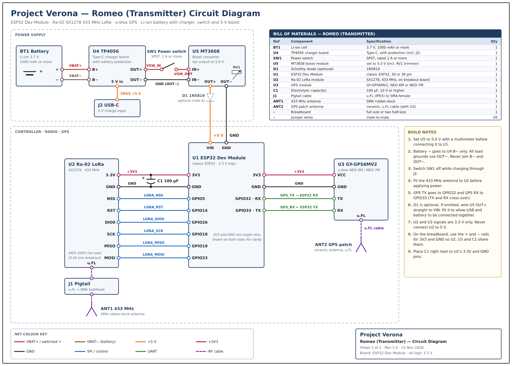

# Project Verona

A two-node GPS tracking system built on ESP32 and 433 MHz LoRa. **Romeo** (transmitter / remote) is a battery-powered tracker that reads its position from a u-blox GPS module. **Juliet** (receiver / base) is a USB-powered station with a 16x2 LCD. Romeo asks *"Wherefore art thou?"* with a `PING` carrying its coordinates; Juliet answers *"Here I am"* with an `ACK` and shows the position.

```
ROMEO (battery)                                                   JULIET (USB)
[GPS + antenna] -UART-> [ESP32] -SPI-> [Ra-02] ))) 433 MHz ((( [Ra-02] <-SPI- [ESP32] -USB-> PC
                                          PING,lat,lon  ->                           |-I2C-> [16x2 LCD]
                                          <-  ACK
```

## Radio protocol

| Packet | From | Payload (ASCII) | Meaning |
|--------|--------|-----------------|---------|
| `PING` | Romeo | `PING,22.572646,88.363895` | "Wherefore art thou?": position with six decimals |
| `ACK` | Juliet | `ACK` | "Here I am": Juliet received the PING |

Romeo sends a PING every 3 seconds, only when the GPS has a valid fix updated within the last 5 seconds, then listens for the ACK for up to 1.5 seconds. Radio: Ra-02 (SX1278) at 433 MHz with the LoRa library defaults, single channel, half-duplex. Packets are not encrypted or addressed.

## Documentation

| File | Contents |
|------|----------|
| `docs/Romeo_Circuit_Diagram.svg` | Full Romeo schematic (Rev 1.1) with bill of materials |
| `docs/Juliet_Circuit_Diagram.svg` | Full Juliet schematic (Rev 1.1 with LCD) with bill of materials |
| `docs/Circuit_Documentation.md` | Netlists, power budget and circuit analysis |
| `tools/gen_diagrams.py` | Regenerates the diagrams: `python tools/gen_diagrams.py docs` (needs `cairosvg` and DejaVu Sans font) |




## Components

### Romeo (transmitter)

| Ref | Component | Specification | Qty |
|-----|-----------|---------------|-----|
| BT1 | Li-ion cell | 3.7 V, 1000 mAh or more | 1 |
| U4 | TP4056 charger board | Type-C, with protection (B+, B-, OUT+, OUT-) | 1 |
| SW1 | Power switch | SPST, rated 1 A or more | 1 |
| U5 | MT3608 boost module | Set output to 5.0 V (RV1 trimmer) | 1 |
| D1 | Schottky diode (optional) | 1N5819 | 1 |
| U1 | ESP32 Dev Module | Classic ESP32, 30 or 38 pin | 1 |
| U2 | Ra-02 LoRa module | SX1278, 433 MHz, on 2.54 mm breakout board | 1 |
| U3 | GPS module | GY-GPS6MV2 (u-blox NEO-6M / NEO-7M) | 1 |
| C1 | Electrolytic capacitor | 100 µF, 10 V or higher | 1 |
| J1 | Pigtail cable | u.FL (IPEX) to SMA-female | 1 |
| ANT1 | 433 MHz antenna | SMA rubber-duck | 1 |
| ANT2 | GPS patch antenna | Ceramic, u.FL cable (with U3) | 1 |
| - | Breadboard | Full-size or two half-size | 1 |
| - | Jumper wires | Male-to-male | 20 |

### Juliet (receiver / base)

| Ref | Component | Specification | Qty |
|-----|-----------|---------------|-----|
| U1 | ESP32 Dev Module | Classic ESP32, 30 or 38 pin | 1 |
| U2 | Ra-02 LoRa module | SX1278, 433 MHz, on breakout board | 1 |
| U3 | LCD with I2C backpack | 16x2 HD44780 + PCF8574, 5 V | 1 |
| C1 | Electrolytic capacitor | 100 µF, 10 V or higher | 1 |
| J1 | Pigtail cable | u.FL (IPEX) to SMA-female | 1 |
| ANT1 | 433 MHz antenna | SMA rubber-duck | 1 |
| J3 | USB data cable | Micro-USB or USB-C (to match U1) | 1 |
| - | Breadboard | Half-size or larger | 1 |
| - | Jumper wires | Male-to-male (8 LoRa + 4 LCD + spares) | 14 |

---

## ⚡ Pin Map & Connections (ESP32 Dev Module)

| Signal | Board Pin (Silkscreen) | ESP32 GPIO | Connected Module Pin | Function |
|:---|:---|:---|:---|:---|
| **LoRa NSS** | **D5** | GPIO 5 | Ra-02 NSS | SPI Chip Select |
| **LoRa RST** | **D14** | GPIO 14 | Ra-02 RST | Reset |
| **LoRa DIO0** | **D26** | GPIO 26 | Ra-02 DIO0 | Packet Rx/Tx Interrupt |
| **LoRa SCK** | **D18** | GPIO 18 | Ra-02 SCK | SPI Clock |
| **LoRa MISO** | **D19** | GPIO 19 | Ra-02 MISO | SPI Master In |
| **LoRa MOSI** | **D23** | GPIO 23 | Ra-02 MOSI | SPI Master Out |
| **GPS TX → ESP32 RX** | **D32** | GPIO 32 | GPS Module TX | UART2 RX (remapped in software) |
| **GPS RX ← ESP32 TX** | **D33** | GPIO 33 | GPS Module RX | UART2 TX (remapped in software) |
| **LCD SDA** | **D21** | GPIO 21 | 16x2 LCD SDA | I2C Data |
| **LCD SCL** | **D22** | GPIO 22 | 16x2 LCD SCL | I2C Clock |

> **Note on D32 / D33:** D32 and D33 are ordinary GPIOs remapped to UART2 in software. They are **not** the board's dedicated hardware RX2/TX2 pins (GPIO 16/17), leaving GPIO 16/17 free to maintain compatibility with ESP32-WROVER boards that reserve them for PSRAM.

---

## 🔌 Detailed Wiring

### Ra-02 LoRa Module (Romeo & Juliet)
* **3.3V** → ESP32 **3V3** *(Do NOT connect to 5V!)*
* **GND** → ESP32 **GND**
* **NSS** → ESP32 **D5** (GPIO 5)
* **RST** → ESP32 **D14** (GPIO 14)
* **DIO0** → ESP32 **D26** (GPIO 26)
* **SCK** → ESP32 **D18** (GPIO 18)
* **MISO** → ESP32 **D19** (GPIO 19)
* **MOSI** → ESP32 **D23** (GPIO 23)
* **C1 (100 µF capacitor):** Connect across Ra-02 3.3V (+) and GND (-) directly at the module to smooth transmit pulses.
* **Antenna:** Connect u.FL pigtail J1 to Ra-02 and attach 433 MHz rubber-duck antenna ANT1 *before* applying power.

### GPS Module (Romeo Only)
* **VCC** → ESP32 **3V3**
* **GND** → ESP32 **GND**
* **TX** → ESP32 **D32** (GPIO 32, RX)
* **RX** → ESP32 **D33** (GPIO 33, TX)
* **Antenna:** Ceramic patch antenna ANT2 connected via u.FL cable (keep flat, metal side down, sky view).

### 16x2 I2C LCD (Juliet Only)
* **VCC** → ESP32 **VIN** (5 V from USB)
* **GND** → ESP32 **GND**
* **SDA** → ESP32 **D21** (GPIO 21)
* **SCL** → ESP32 **D22** (GPIO 22)
* **Default I2C Address:** `0x27` (or `0x3F`)

### Romeo Power Chain
```
Li-ion Cell (+) -> TP4056 B+
Li-ion Cell (-) -> TP4056 B-
TP4056 OUT+     -> Power Switch (SW1) -> MT3608 IN+
TP4056 OUT-     -> MT3608 IN- (GND OUT-)
MT3608 OUT+     -> [Optional 1N5819 Diode D1] -> ESP32 VIN (5.0 V)
MT3608 OUT-     -> ESP32 GND
```
> **CAUTION:** On the protected TP4056, **B-** and **OUT-** are different nets joined only through the protection MOSFET. Never bridge B- and OUT-. Calibrate MT3608 with a multimeter to 5.0 V before connecting it to the ESP32 VIN pin.

---

## 💻 Firmware

### Arduino IDE
| Sketch | Board | Purpose |
|--------|-------|---------|
| `firmware/Romeo/Romeo.ino` | ESP32 Dev Module | Reads GPS on UART2 (D32/D33), broadcasts PING every 3 s, listens for ACK |
| `firmware/Juliet/Juliet.ino` | ESP32 Dev Module | Listens for PING, replies ACK, displays coordinates on 16x2 LCD |

1. Install **Arduino IDE 2.x** and add the **esp32 by Espressif** board package (select *ESP32 Dev Module*).
2. Install libraries via Library Manager:
   - **LoRa** by Sandeep Mistry
   - **TinyGPSPlus** by Mikal Hart
   - **LiquidCrystal I2C** by Frank de Brabander
3. Open each sketch, upload to its respective board, and open the Serial Monitor at **9600 baud**.

### PlatformIO
The repository is fully configured for PlatformIO (`platformio.ini`):
```bash
# Upload Romeo firmware (GPS transmitter)
pio run -e romeo --target upload
pio device monitor -b 9600

# Upload Juliet firmware (LCD receiver)
pio run -e juliet --target upload
pio device monitor -b 9600

# Run I2C Scanner to detect LCD address
pio run -e i2c_scan --target upload
pio device monitor -b 9600
```

---

## 🎯 Expected Output

* **Romeo Serial Monitor:**
  ```text
  PING sent: 22.572646,88.363895
  ACK from Juliet (RSSI -62 dBm)
  ```
* **Juliet Serial Monitor & LCD:**
  ```text
  PING from Romeo: 22.572646,88.363895 (RSSI -62 dBm)
  ACK sent
  ```
  LCD Row 1: `Lat:22.572646`  
  LCD Row 2: `Lon:88.363895`

---

## 🔍 Troubleshooting

| Symptom | Cause & Solution |
|:---|:---|
| `LoRa Error` | Check 3.3V power rail, verify SPI wiring (D5, D14, D26, D18, D19, D23), ensure 100 µF capacitor C1 is installed. |
| Romeo: Satellites stay 0 | Move outdoors with clear sky view; verify GPS TX→D32 and RX→D33 crossover; check patch antenna connection. |
| Romeo: `No ACK` | Ensure both 433 MHz antennas are attached; test in close proximity first; confirm Juliet is powered and running. |
| LCD Blank / No text | Adjust contrast potentiometer on back of I2C module; change address in sketch from `0x27` to `0x3F` (run `i2c_scan` to verify). |
| Romeo resets on battery | Calibrate MT3608 trimmer to precisely 5.0 V; verify battery can supply peak current; ensure C1 capacitor is connected across Ra-02 3V3/GND. |
